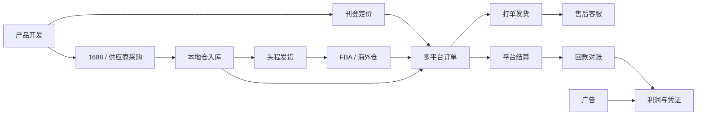

<p align="center">
  
</p>

<h1 align="center">柠檬跨境ERP · Lemon Ecom ERP</h1>

<p align="center">
  <b>一套系统，管好全球店铺。开源、免费、可私有化部署的跨境电商 ERP</b><br />
  亚马逊、速卖通、虾皮、Lazada、TikTok Shop、Temu、eBay、Shopify、沃尔玛、Ozon、美客多多平台多店铺统一管理，<br />
  选品采购、刊登定价、订单发货、FBA 与海外仓、广告、售后、结算回款到利润核算全流程打通
</p>

<p align="center">
  <a href="https://github.com/MakeSomeFakeNews/lemon-ecom/actions/workflows/ci.yml"></a>
  <a href="https://github.com/MakeSomeFakeNews/lemon-ecom/releases/latest"></a>
  <a href="https://github.com/MakeSomeFakeNews/lemon-ecom/stargazers"></a>
  <a href="LICENSE"></a>
  
  
  
  
  
</p>

<p align="center">
  <a href="https://makesomefakenews.github.io/lemon-ecom-website/"><b>官网</b></a> ·
  <a href="https://makesomefakenews.github.io/lemon-ecom-website/manual/guide/"><b>用户手册</b></a> ·
  <a href="https://makesomefakenews.github.io/lemon-ecom-website/dev/start/"><b>开发文档</b></a> ·
  <a href="#快速开始"><b>快速开始</b></a> ·
  <a href="#联系方式"><b>联系我们</b></a> ·
  <a href="#english"><b>English</b></a>
</p>

<p align="center">
  
</p>

## 项目简介

**柠檬跨境ERP（Lemon Ecom ERP）是一套开源、可私有化部署的跨境电商 ERP。** 从选品开发、1688 采购、头程发货、刊登定价，到多平台订单处理、FBA 与海外仓、广告、售后、平台结算和利润核算，跨境卖家每天要做的事在一套系统里完成。与常见的按店铺数、订单量收费的 SaaS ERP 不同，柠檬跨境ERP 全部源码开放，不限店铺、账号和订单量，数据保存在你自己的服务器上。

<table>
  <tr>
    <td align="center" width="16%"><b>11</b><br />电商平台连接器</td>
    <td align="center" width="16%"><b>3 + 3</b><br />海外仓 / 物流商对接</td>
    <td align="center" width="16%"><b>业财一体</b><br />订单到凭证自动生成</td>
    <td align="center" width="16%"><b>19 × 12</b><br />自动化触发事件 × 动作</td>
    <td align="center" width="16%"><b>5</b><br />国产大模型可选</td>
    <td align="center" width="16%"><b>0 元</b><br />不限店铺与订单量</td>
  </tr>
</table>

### 卖家的难题，我们这样解决

| 你遇到的问题 | 柠檬跨境ERP 的做法 |
| --- | --- |
| 店铺开了十几个，每天在各平台后台来回切换处理订单？ | 11 个平台统一授权、自动拉单、回传发货和库存；审单规则自动分仓、选物流、打标签、挂起风险订单，批量取号打面单、扫描发货 |
| 每月看着流水在涨，算下来却不知道赚没赚钱？ | 结算报告回写真实佣金和配送费，仓储费、广告费、头程、VAT 分摊到订单和 SKU；订单口径与结算口径两套利润报表，全部折算本位币 |
| FBA 一断货排名就掉，一压货仓储费就涨？ | 按加权日均销量与在途库存算补货建议，FBA 库存健康展示超龄、冗余库存和预估仓储费并给出处理建议；头程货件即在途调拨，到货自动入平台仓 |
| 广告越投越多，ACoS 一直降不下来？ | Amazon Ads 数据按活动 / 搜索词 / SKU 拆到 TACOS，广告规则自动调竞价、否词，分时策略按时段调价 |
| 财务月底对账要对一周，平台回款和应收对不上？ | 订单出库即生成成本和应收，结算报告生成收款单核销应收，PingPong、连连、Payoneer 到账流水自动匹配并处理汇兑差额 |
| 运营人多了，权限和业绩说不清？ | 运营只看负责和被授权的店铺，按店铺的数据权限覆盖订单、商品、广告、利润；运营目标与绩效按人按店考核 |
| 重复工作太多，人一直在盯后台？ | 自动化规则中心内置「1 星差评自动建售后工单」「可售天数低于 15 天自动生成采购计划」「预估亏损订单自动挂起」「ACOS 过高暂停活动」「被跟卖立即通知负责人」等模板；AI 运营日报每天推送到钉钉 / 企业微信 / 飞书 |

### 覆盖跨境卖家的全流程



### 为什么选择柠檬跨境ERP

- **真正开源，没有收费版**：仓库里就是全部功能，没有授权码和功能阉割，不按店铺、账号、订单量收费；GPL-3.0 协议，可以免费商用
- **数据在自己手里**：私有化部署在自己的服务器或云主机上，店铺授权、订单、利润等经营数据不经过任何第三方
- **业财一体，不只是订单工具**：底层是一套完整 ERP，平台订单、采购、调拨都生成真实的库存流水、成本和会计凭证，利润和财务报表口径一致，不需要再导出到另一套财务软件
- **AI 与自动化**：AI 问数直接问「上个月哪个店铺利润最高」「哪些 SKU 要紧急补货」；AI 写 Listing 并检查违禁词，草拟买家消息和评价回复；自动化规则把重复操作交给系统
- **可以拿来做 SaaS**：内置多租户、租户套餐和行业模板，服务商可以直接为多家卖家提供在线服务
- **方便二次开发**：Spring Boot 4 + Vue 3，模块单向依赖，新增平台只需实现一个连接器接口；自带完整演示数据、用户手册和开发文档

### 适合谁用

- **中小跨境卖家**：用一台服务器部署，免费管理全部店铺和订单，省下每月的 ERP 订阅费
- **品牌卖家与工贸一体企业**：需要业财一体、审批流、精细化利润和按店铺的权限管理
- **软件服务商与开发者**：以本项目为基础，为客户做部署实施、定制开发或 SaaS 运营

> 如果这个项目对你有帮助，请点一下右上角的 **Star**，这是对我们最大的鼓励！

## 功能总览

按顶部导航的模块：

<table>
  <tr><th width="120">模块</th><th>主要功能</th></tr>
  <tr><td><b>商品管理</b></td><td><b>商品资料</b>：本地商品（多规格、辅助单位与条码、图片、参考成本）、在线商品（店铺 × 平台 SKU 映射本地物料与多件装、组合商品、SPU / 变体视图、FNSKU 标签）、SKU 配对（推荐物料、批量导入）；<b>刊登定价</b>：刊登中心（一份草稿刊登到多个店铺，接口选类目与属性，后台队列发布）、刊登模板、价格模板、自动调价（跟随最低价 / 购物车价、目标利润率、按库存销量）、竞品价格、改价记录；<b>产品开发</b>：开发项目（调研、样品、审批后生成商品）、开发看板、利润试算（佣金、FBA 配送费估算、头程、VAT、广告与退货）</td></tr>
  <tr><td><b>订单管理</b></td><td><b>订单处理</b>：平台订单（同步 / 导入 / 手工建单 / 补发，按状态分页签，审核、缺货检查、挂起、合并拆分）、包裹打单（批量取号、合并打印面单与拣货单、批量发货）、扫描发货、物流跟踪（轨迹归一与超时预警）；<b>售后客服</b>：退货退款（仅退款 / 退货入库，冲减成本、重算利润）、售后工单、买家消息、评价管理（AI 草拟回复与翻译）、回复模板；<b>订单设置</b>：订单规则、订单标签、买家黑名单、偏远地区</td></tr>
  <tr><td><b>运营管理</b></td><td><b>店铺管理</b>：平台店铺（站点、币种、时区、发货仓与平台仓、佣金率、渠道授权）、渠道接入（各店铺授权状态与同步结果）、店铺授权（运营只看负责和被授权的店铺）；<b>广告管理</b>：广告数据（概览、活动层级、搜索词、SKU 与 TACOS、分时策略、广告授权）、广告规则；<b>运营监控</b>：ASIN 监控、促销管理、运营目标、运营绩效；<b>数据分析</b>：电商看板、利润分析（多维、两种口径）、销量统计、销量预测、商品分析（ABC、滞销、库龄）；<b>智能运营</b>：AI 运营日报（每日自动生成并推送钉钉 / 企业微信 / 飞书）、违禁词库与 AI 写 Listing、自动化规则中心（19 种触发事件 + 条件 + 12 种动作，执行日志、试运行、规则模板）、待办提醒；AI 问数内置电商数据工具（利润下滑归因、广告、退货差评、断货风险等）</td></tr>
  <tr><td><b>物流管理</b></td><td><b>头程物流</b>：发货计划、头程货件（装箱、装箱单与箱唛、在途调拨、单件头程成本、可接入审批）、物流渠道（目的国 × 重量段费率、运费试算、对接物流商取号）；<b>FBA</b>：平台仓库存比对、FBA 库存健康、移除订单、FBA 索赔、FBA 费用核查、亚马逊报告；<b>海外仓</b>：账号与仓库 / SKU 映射、库存同步与差异调整、入库、一件代发出库、费用入账、退件质检、调拨、收货差异</td></tr>
  <tr><td><b>供应链</b></td><td><b>补货采购</b>：补货建议（平台仓补货 / 本地仓采购，加权日均与断货日排除）、采购计划、采购订单、采购入库、采购退货、安全库存补货；<b>1688 采购</b>：1688 账号、货源（价格库存同步与调价提醒）、一键下单与采购单跟踪；<b>批发销售</b>：销售订单、销售出库、销售退货、商品速查；<b>往来单位</b>：供应商（含物流公司）、客户、资料合并；<b>进销存报表</b>：销售、进货、经营状况、资产状况、商品分析、客户分析</td></tr>
  <tr><td><b>仓库管理</b></td><td>入库、出库、调拨（含在途）、盘点、组装拆卸，冲销；库存查询（实时移动加权均价与金额、经营历史）、库存流水、批次与序列号、收发存汇总、库存冻结；仓库、库位、规格属性；手机 / PDA 扫码收货、上架、盘点</td></tr>
  <tr><td><b>财务管理</b></td><td><b>平台结算</b>：平台结算（导入结算报告，费用回写订单，生成收款单核销应收）、回款对账（PingPong、连连、Payoneer 等到账流水匹配与汇兑差额）、费用映射、税务（VAT / GST / 销售税、VAT 汇总）；总账、应收应付、资金与费用、资产与成本、预算与分析、期末结账与币种汇率</td></tr>
  <tr><td><b>智能</b></td><td>AI 问数、智能录入、数据整理、智能报告、AI 设置（按租户配置模型、功能开关与用量上限）</td></tr>
  <tr><td><b>流程中心</b></td><td>仿钉钉流程设计器（条件分支、并行分支、会签 / 或签）与表单设计；待办 / 已办 / 抄送 / 我的申请、流程实例；头程货件、开发项目、采购订单、出入库、凭证、付款、报销等一键接入审批</td></tr>
  <tr><td><b>系统</b></td><td>用户、部门、角色、菜单 / 按钮 / 数据权限，字典与业务字典、编码规则、打印模板、业务参数、自定义字段、通知公告、钉钉 / 企业微信 / 飞书集成；系统监控（在线用户、日志、服务与缓存监控、定时任务）；SaaS 多租户；中英文界面</td></tr>
  <tr><td><b>小程序</b></td><td>微信小程序：审批、消息与公告、商品速查、快速开单、快速入库、单据草稿、库存查询与扫码作业</td></tr>
</table>

每个功能的使用方法见 [用户手册](https://makesomefakenews.github.io/lemon-ecom-website/manual/guide/)。

## 支持的平台与第三方

| 类别 | 对接 | 能力 |
| --- | --- | --- |
| 电商平台 | 亚马逊、速卖通、虾皮 Shopee、Lazada、TikTok Shop、Temu、eBay、Shopify、沃尔玛 Walmart、Ozon、美客多 Mercado Libre | 授权（OAuth 或密钥）、拉取订单、回传发货（亚马逊、eBay、Shopify、TikTok Shop、沃尔玛、Temu 支持按包裹部分回传）、回传库存、同步在线商品、刊登 / 改价 / 下架 |
| 广告 | Amazon Ads（SP / SB / SD） | OAuth 授权、同步结构与报告、修改竞价 / 预算 / 状态、否定关键词 |
| 客服 | 虾皮聊天、TikTok Shop 客服、亚马逊请求评价 | 同步会话与评价、回复、请求评价 |
| 海外仓 | 谷仓、万邑通 WINIT、4PX 海外仓 | 仓库与物流产品、库存、入库、一件代发、退件、调拨、费用 |
| 物流商 | 4PX 递四方、云途 YunExpress、17TRACK | 下单取号、面单、取消、物流轨迹 |
| 采购 | 1688 开放平台 | OAuth、货源详情与价格同步、一键下单、订单与物流跟踪 |
| 协同 | 钉钉、企业微信、飞书、微信小程序 | 扫码登录、消息推送、通讯录同步、审批提醒 |
| 大模型 | DeepSeek、通义千问、智谱 GLM、Kimi、豆包（OpenAI 兼容） | AI 问数、草拟回复与翻译、智能录入、经营报告 |

各连接器按官方公开文档实现，并用本地模拟服务测试了签名、授权、分页和报文，**尚未用真实开发者账号联调**；正式接入前请用自己的账号验证（需要核对的点写在各连接器的 javadoc 中）。新增平台只需实现对应的连接器接口，见 [开发文档 - 连接器设计](https://makesomefakenews.github.io/lemon-ecom-website/dev/architecture/connector)。

## 截图

以下截图均来自自带演示数据的系统。

<table>
  <tr>
    <td width="50%"><b>平台订单</b><br /></td>
    <td width="50%"><b>在线商品</b><br /></td>
  </tr>
  <tr>
    <td><b>刊登中心</b><br /></td>
    <td><b>广告数据</b><br /></td>
  </tr>
  <tr>
    <td><b>利润分析</b><br /></td>
    <td><b>FBA 库存健康</b><br /></td>
  </tr>
  <tr>
    <td><b>海外仓库存</b><br /></td>
    <td><b>补货建议</b><br /></td>
  </tr>
  <tr>
    <td><b>平台结算</b><br /></td>
    <td><b>渠道接入</b><br /></td>
  </tr>
  <tr>
    <td><b>开发看板</b><br /></td>
    <td><b>深色模式</b><br /></td>
  </tr>
</table>

## 快速开始

### 方式一：免装数据库体验

只需要 JDK 17 和 Node 20+：

```bash
./gradlew bootTestRun                         # 后端：H2 内存库 + 内存缓存
cd lemon-web && npm install && npm run dev    # 前端：http://localhost:5173
```

后端启动完成后会自动生成一套**演示数据**（约 1–2 分钟，看板上显示进度）：一个跨境卖家的 10 个平台店铺（亚马逊美 / 德 / 日、虾皮、TikTok Shop、Temu、速卖通、Shopify、eBay 等）、40 个带图片的商品、供应商与采购、头程货件、近 120 天约 5000 张订单（各作业环节都有）、退货、结算回款、广告、客服、FBA、海外仓、产品开发与 1688 采购、补货与预测。`bootTestRun` 以 SaaS 模式运行，登录时租户填「柠檬科技」；设置 `LEMON_ECOM_DEMO_DATA=false` 可以关闭演示数据。

### 方式二：Docker 一键部署

安装了 Docker（含 Compose v2）时，一条命令启动 MySQL、Redis、后端和前端：

```bash
cd docker
cp .env.example .env        # 修改其中的密码和 JWT_SECRET；需要演示数据时设置 LEMON_ECOM_DEMO_DATA=true
docker compose up -d --build
```

启动完成后访问 http://localhost（端口见 `.env` 中的 `WEB_PORT`）。也可以使用 Release 中的 Docker 部署包，直接拉取 `ghcr.io` 上的镜像。

### 方式三：源码运行（MySQL + Redis）

```bash
# 1. 初始化数据库（会删除并重建全部表）
mysql -uroot -p -e "CREATE DATABASE lemon_ecom DEFAULT CHARSET utf8mb4"
mysql -uroot -p lemon_ecom < sql/init.sql

# 2. 启动后端（默认连接本机 MySQL root / root 和本机 Redis，
#    可用 DB_URL、DB_USERNAME、DB_PASSWORD、REDIS_HOST、REDIS_PORT、REDIS_PASSWORD 覆盖）
DB_PASSWORD=你的密码 ./gradlew bootRun

# 3. 启动前端，访问 http://localhost:5173（/api 自动代理到 http://localhost:8080）
cd lemon-web && npm install && npm run dev
```

**默认账号**：`admin` / `admin123`（超级管理员）、`test` / `admin123`（只读用户）。开启 SaaS 多租户（`LEMON_TENANT_ENABLED=true`）后登录需要填写租户「柠檬科技」。

**接入平台**：在「运营管理 → 平台店铺」中新建店铺，填写渠道授权（OAuth 平台点「授权」跳转到平台）后测试授权、同步订单；部署在反向代理后面时设置 `LEMON_ECOM_PUBLIC_URL`（含 `/api` 的后端外网地址），并在平台开发者后台登记回调地址 `<后端外网地址>/ecom/oauth/callback/<平台>`。详见 [部署文档](https://makesomefakenews.github.io/lemon-ecom-website/dev/deploy/)。

## 技术栈

| 分类 | 技术 | 环境要求 |
| --- | --- | --- |
| 后端 | Java 17、Spring Boot 4.1、Spring Security + JWT、MyBatis-Plus 3.5、Flowable 8、JasperReports 7；平台接口用 JDK HttpClient 自行实现签名与 OAuth | JDK 17 |
| 数据与缓存 | MySQL、Redis（可切换为内存缓存） | MySQL 8.0+、Redis 6.2+ |
| 前端 | Vue 3.5、Vite 7、Ant Design Vue 4.2、Pinia、Vue Router、ECharts 5、vue-i18n | Node 20+ |
| 小程序 | uni-app（Vue 3），微信小程序 | 微信开发者工具 |
| 构建部署 | Gradle 多模块、Docker / Docker Compose、Nginx、GitHub Actions | Docker 20.10+、Nginx 1.20+ |

## 项目结构

```
lemon-ecom
├── lemon-common        通用层：统一返回、异常、基础实体、工具类
├── lemon-framework     框架层：安全、数据权限、多租户、缓存、日志、定时任务、模块间契约接口
├── lemon-modules       业务模块
│   ├── lemon-system    系统管理        ├── lemon-scm   供应链：采购、出入库、客户 / 供应商、商品速查
│   ├── lemon-monitor   系统监控        ├── lemon-fin   财务管理
│   ├── lemon-workflow  流程中心        ├── lemon-ecom  跨境电商：店铺、商品、刊登、订单、物流、FBA、海外仓、
│   ├── lemon-dashboard 工作台          │               广告、客服、结算、利润、产品开发、1688、进销存报表
│   └── lemon-wms       仓库管理        └── lemon-ai    智能（AI）
├── lemon-admin         启动模块：组装全部业务模块，打包为可执行 jar；集成测试
├── lemon-web           前端（Vite + Vue 3 + Ant Design Vue）
├── lemon-mp            微信小程序（uni-app + Vue 3）
├── sql/init.sql        建表与初始数据
├── docker              Dockerfile、docker-compose 与镜像构建脚本
└── docs                开发说明（development.md）
```

模块依赖只允许单向：`wms ← scm ← fin ← ecom`，`system ← monitor ← dashboard`，`workflow`、`ai` 只依赖 framework。

## 文档

| 文档 | 地址 |
| --- | --- |
| 官网 | https://makesomefakenews.github.io/lemon-ecom-website/ |
| 用户手册 | https://makesomefakenews.github.io/lemon-ecom-website/manual/guide/ |
| 开发文档 | https://makesomefakenews.github.io/lemon-ecom-website/dev/start/ |
| 部署文档 | https://makesomefakenews.github.io/lemon-ecom-website/dev/deploy/ |
| 完整的设计说明 | [docs/development.md](docs/development.md) |

## 开源协议

柠檬跨境ERP 基于 [GPL-3.0](LICENSE) 协议开源，仓库中的就是全部功能，没有商业版、没有授权码：

- **可以免费商用**：个人与企业都可以免费使用、修改、部署，用于自己的业务，或为客户提供部署、实施、SaaS 等服务
- **衍生作品须开源**：分发修改后的版本或基于本项目的衍生作品时，须同样以 GPL-3.0 协议公开完整源码，并保留原有的版权声明与许可证
- **没有功能限制**：系统本身不限制用户数、店铺数、租户数和单据量
- **数据自主可控**：私有化部署在自己的服务器上

## 致谢

柠檬跨境ERP 由开源项目 [柠檬ERP](https://github.com/MakeSomeFakeNews/lemon-erp)（Apache-2.0）衍生：去掉了生产制造、质量、客户关系、项目管理、人力资源、商务智能和门户，保留了其仓库、采购、财务、流程中心和系统平台能力，并在此之上新增了跨境电商模块。来自柠檬ERP 的代码保留其原有版权声明。

同时感谢 Spring Boot、MyBatis-Plus、Flowable、JasperReports、Vue、Ant Design Vue、ECharts、uni-app 等开源项目。

## 联系方式

商务合作、定制开发、部署实施或使用中遇到问题，欢迎联系：

- 电话：17701123202
- 微信：BG7LIF
- 邮箱：zmissu@163.com

也欢迎在 [Issues](https://github.com/MakeSomeFakeNews/lemon-ecom/issues) 中反馈问题和建议，或提交 Pull Request 一起完善。如果觉得柠檬跨境ERP 不错，请点一个 **Star**，也欢迎推荐给身边做跨境电商的朋友。

## English

**Run all your global stores in one system.** Lemon Ecom ERP is an open-source, self-hosted ERP for cross-border e-commerce sellers, built with **Spring Boot 4 + Vue 3 + Ant Design Vue 4**. It manages multiple stores on Amazon, AliExpress, Shopee, Lazada, TikTok Shop, Temu, eBay, Shopify, Walmart, Ozon and Mercado Libre, and covers the whole seller workflow: product development, 1688 sourcing, first-mile shipping, listing and repricing, order fulfillment, FBA and overseas warehouses, advertising, after-sales, settlements, payouts and profit, all on top of real inventory, cost and accounting. Unlike subscription ERPs priced by store or order volume, it is fully open source with no paid edition and no limits on stores, users or orders, and your data stays on your own server.

- **Multi-platform stores**: 11 channel connectors for authorization (OAuth or keys), order sync, shipment confirmation (per-package partial shipment where supported), inventory push, listing sync, publishing and repricing; stores without an API can import orders, settlements, ad reports and inventory reports from Excel
- **Order fulfillment**: order rules assign warehouses, shipping channels and tags or hold risky orders; merge / split packages, batch labels and pick lists, scan-to-ship, address validation, buyer blacklist, tracking with delay alerts; returns, after-sales tickets, buyer messages and reviews
- **FBA and overseas warehouses**: marketplace and 3PL warehouses are regular warehouses, inbound shipments are in-transit transfers with landed cost per unit; FBA inventory health, removals, reimbursement claims and fee audits; Goodcang, WINIT and 4PX warehouse inbound, fulfillment, returns, transfers and fees
- **Profit you can trust**: settlement reports write actual fees back to orders, storage and other unlinked fees are allocated to SKUs, VAT is separated, ads are deducted by store / SKU; multi-dimensional profit reports on order basis and settlement basis, in the base currency with monthly exchange rates
- **Operations**: listing center, price templates, automatic repricing and competitor prices, Amazon Ads (SP / SB / SD) rules and dayparting, ASIN monitoring, promotions, targets and performance, sales forecasting and replenishment, product development and 1688 sourcing
- **AI operations and automation**: AI analytics tools for e-commerce data (profit decline attribution, ads, returns and reviews, stock-out risk), a daily AI operations report pushed to DingTalk / WeCom / Feishu, AI listing writer with banned-word checks, and an automation rule center (19 triggers, conditions, 12 actions such as notify, webhook, hold order, reprice, create purchase plans or tickets, pause ads; with test runs, logs and templates)
- **Integrated accounting**: order shipments become sales deliveries that reduce stock, post cost and create receivables; settlements create receipts that clear store receivables; payout reconciliation with FX differences; vouchers, ledgers and financial statements
- **Platform**: visual approval workflow (Flowable), SaaS multi-tenancy with industry templates, menu / button / API permissions, department data permissions and store-level data permissions, AI assistants (DeepSeek, Qwen, GLM, Kimi, Doubao), WeChat mini program, DingTalk / WeCom / Feishu, Chinese and English UI, Docker deployment

Connectors are implemented from the platforms' public documentation and tested against local mock servers; verify them with your own developer accounts before production use.

**Quick start** without MySQL / Redis: `./gradlew bootTestRun`, then `cd lemon-web && npm install && npm run dev` and open http://localhost:5173 (tenant「柠檬科技」, `admin` / `admin123`). A complete demo seller is generated automatically in about 1–2 minutes (10 stores, 40 products with images, 120 days of orders, inbound shipments, settlements, ads, customer service, FBA, overseas warehouses and more). With Docker: `cd docker && cp .env.example .env && docker compose up -d --build`, set `LEMON_ECOM_DEMO_DATA=true` in `.env` for demo data.

**Documentation**: [website](https://makesomefakenews.github.io/lemon-ecom-website/) · [user manual](https://makesomefakenews.github.io/lemon-ecom-website/manual/guide/) · [developer docs](https://makesomefakenews.github.io/lemon-ecom-website/dev/start/) (in Chinese).

**License**: [GPL-3.0](LICENSE). Free for commercial use; if you distribute a modified version or a derivative work, it must also be released under GPL-3.0 with its complete source code. Lemon Ecom ERP is derived from the open-source [Lemon ERP](https://github.com/MakeSomeFakeNews/lemon-erp) (Apache-2.0), whose copyright notices are retained.

Contact: zmissu@163.com

---

<p align="center">GPL-3.0 © 2026 柠檬跨境ERP</p>
